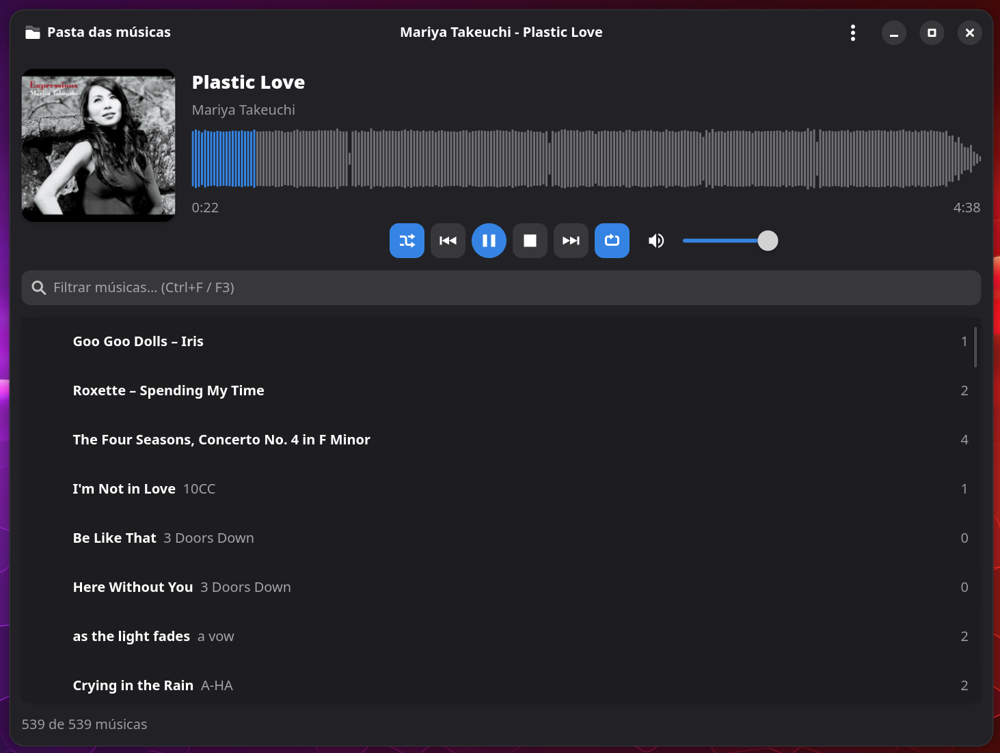

# Music Player

Player de música com interface gráfica para Linux (GTK4 + libadwaita + GStreamer), escrito em Python.



## Recursos

- Play/Pause (um botão, dois estados), Stop, Próxima e Anterior
- Shuffle com algoritmo **Fisher-Yates** e equilíbrio de frequência: só sorteia entre as músicas menos tocadas, para nenhuma ser tocada mais que as outras (contadores em arquivo rotativo)
- Repetir com 3 estados em um botão: desligado / todas / uma
- Filtro de músicas (`Ctrl+F` ou `F3`): próxima/anterior obedecem a lista filtrada; o filtro não persiste ao reabrir
- Forma de onda da música com seek por clique/arraste
- Capas: `.covers/<Artista>.jpg` (mesmo esquema do kew), `cover.jpg`/`folder.jpg` ou capa embutida na música
- Estado persistente: lista de músicas, música atual, posição, volume, shuffle e repeat
- Sempre inicia tocando; volume inicia em 100% até você alterá-lo
- Busca recursiva na pasta pai das músicas (botão **Pasta das músicas**, `Ctrl+O`)
- Menu de clique direito na lista: copiar path, abrir pasta (com a música selecionada) e deletar (envia para a lixeira, com confirmação)
- Integração MPRIS (teclas de mídia e controles do desktop)

Os arquivos devem seguir o padrão `Artista - Título.mp3`.

## Requisitos (Arch Linux)

```sh
sudo pacman -S python-gobject gtk4 libadwaita gst-plugins-base gst-plugins-good gst-libav
```

## Uso

```sh
./iniciar.sh
```

O script encerra outras instâncias abertas antes de iniciar. Para ter um atalho no menu de aplicativos:

```sh
cp br.local.MusicPlayer.desktop ~/.local/share/applications/
```

Pasta padrão das músicas: `/mnt/disco_d/meus_documentos/Musicas/` (altere em `DEFAULT_FOLDER` ou pelo botão da interface).

## Atalhos

| Atalho | Ação |
|---|---|
| `Ctrl+Espaço` | Play/Pause |
| `Ctrl+→` / `Ctrl+←` | Próxima / Anterior |
| `Ctrl+S` | Shuffle |
| `Ctrl+R` | Repeat (off → todas → uma) |
| `Ctrl+O` | Escolher pasta das músicas |
| `Ctrl+F` / `F3` | Filtrar |

## Dados

Salvos em `~/.local/share/musicplayer/`:

- `state.json` — estado do player
- `frequency.json` — contador de execuções por música
